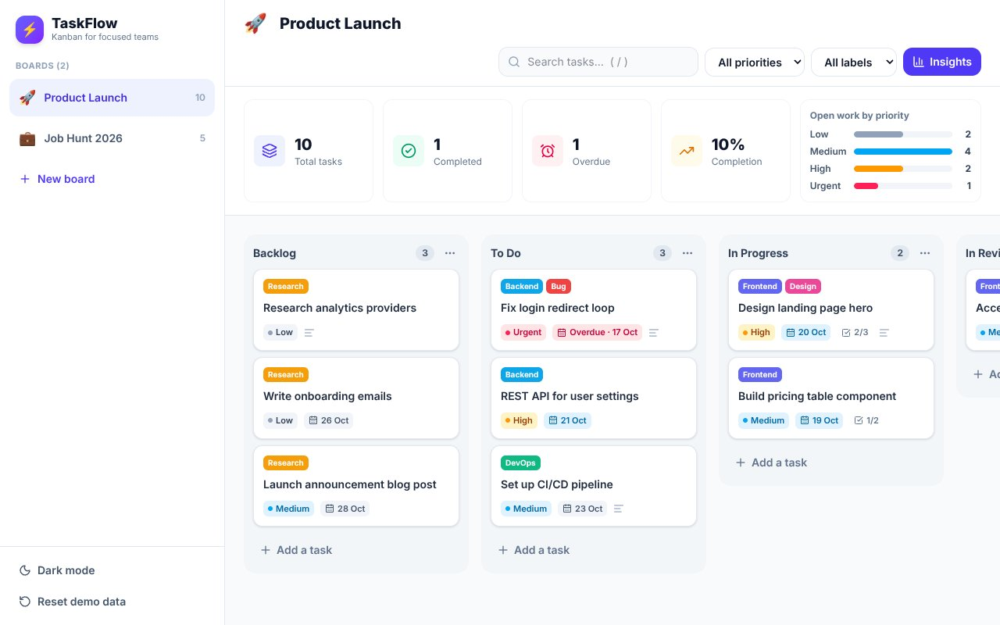
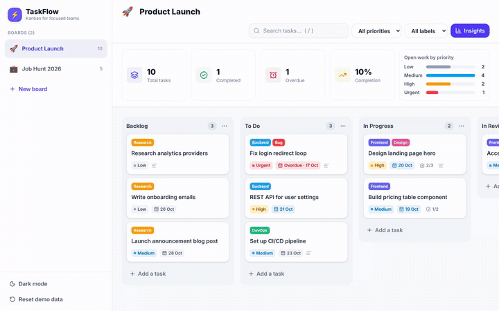

# ⚡ TaskFlow — Kanban project manager

**Live demo:** [taskflow-kanban-jeevan.vercel.app](https://taskflow-kanban-jeevan.vercel.app)





A Trello-style Kanban board for planning projects (or your job hunt!). Drag tasks between lists, track priorities and deadlines, and see progress at a glance.

**Tech:** React 19 · TypeScript · Vite · Tailwind CSS v4 · dnd-kit · Zustand (persisted) · Lucide icons

## Features

- **Multiple boards** — create, rename, switch and delete boards (ships with *Product Launch* and *Job Hunt 2026* demo boards)
- **Drag & drop** tasks within and across lists, with pointer **and keyboard** support (dnd-kit sensors + drag overlay)
- **Custom lists** — add, rename (double-click) and delete columns; the last list is treated as "Done"
- **Rich task details** — priority, colour labels, due dates, description and a checklist with a progress bar
- **Smart badges** — overdue / due-today / due-soon indicators and checklist completion on every card
- **Search & filters** by text, priority and label (press <kbd>/</kbd> to focus search)
- **Insights panel** — total, completed, overdue, completion rate and open work by priority
- **Dark mode** and **offline persistence** via `localStorage`
- Fully responsive with a slide-in sidebar on mobile

## Getting started

```bash
npm install
npm run dev       # http://localhost:5173
npm run build     # type-check + production build
npm run lint      # oxlint
```

## Architecture

```
src/
├── store.ts               # Zustand store: boards, columns, tasks, actions (persisted)
├── types.ts               # Domain types
├── lib/                   # Seed data, filters, date & priority helpers
└── components/
    ├── BoardView.tsx      # DndContext, sensors, drag-over / drag-end logic
    ├── Column.tsx         # Droppable list + SortableContext
    ├── TaskCard.tsx       # Sortable card
    ├── TaskModal.tsx      # Task editor dialog
    ├── Insights.tsx       # Board analytics
    └── Sidebar.tsx        # Boards, theme & reset
```
